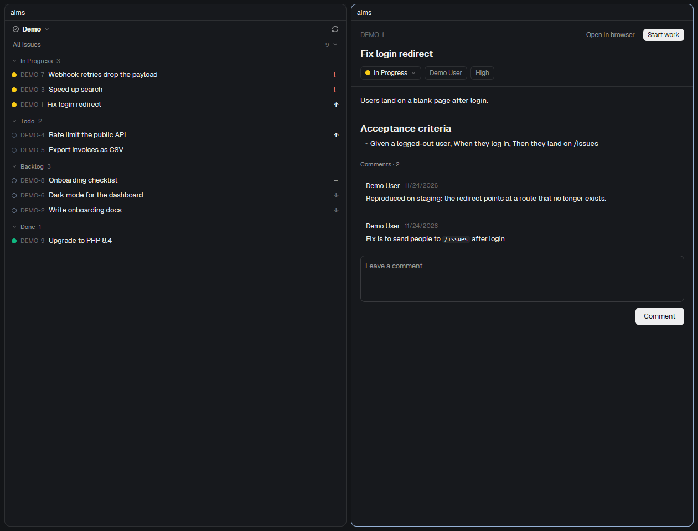

# AIMS for Herdr

A [Herdr](https://herdr.dev) mod that puts an [AIMS](https://github.com/christianpasinrey/open-aims) issue tracker beside your terminals: issues by state, an issue pane with comments and status, "Start work" on an issue with a coding agent, and a browser for the workspace's code graph.



## Install

Ask your agent in Herdr to add `christianpasinrey/herdr-aims`, or copy `mods/aims/` into `~/.config/herdr-app/mods/`.

Then, in Herdr: command palette → **AIMS: connect**, and enter your instance address and a personal token (AIMS → Settings → Developer → Personal tokens).

To show the panel, add a block to your layout:

```json
{ "id": "aims", "type": "block", "size": { "weight": 1 }, "min": 90, "content": { "mod": "aims", "props": { "view": "sidebar" } } }
```

In the shipped `main` layout it goes in `sidebar-lists`, between `spaces` and `agents` (clone `main` first: shipped layouts are read-only).

## What it touches

- The network: only the AIMS instances you connect.
- `git`, when you start work in a new worktree.
- One file outside its folder: `aims.json` in your Herdr home, where connections and tokens are kept in plain text.

`RECIPE.md` describes the whole build.

## License

MIT
