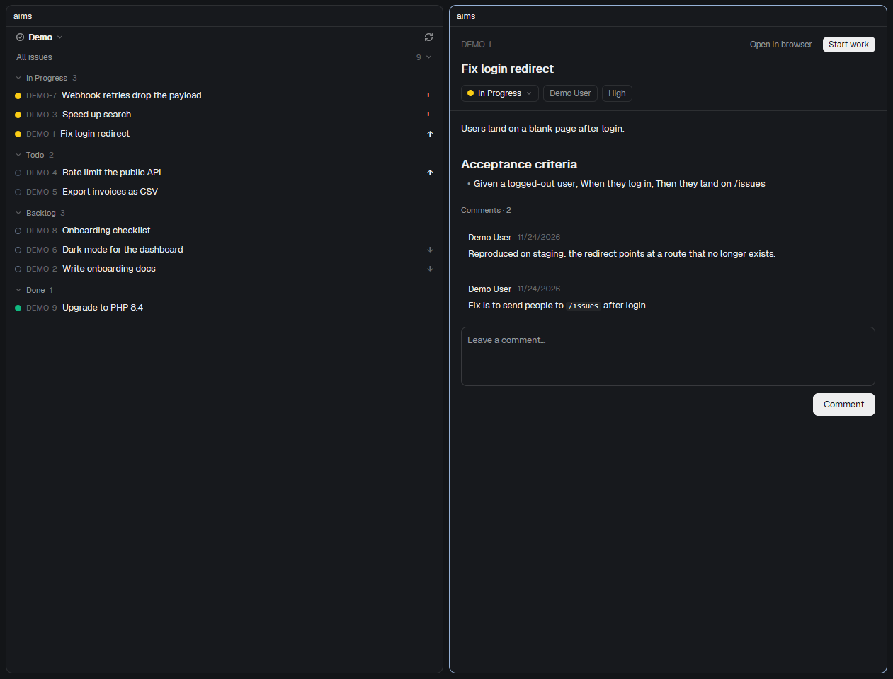

# AIMS

Your [AIMS](https://github.com/christianpasinrey/open-aims) issue tracker inside Herdr: a panel that lists a workspace's issues by state, an issue pane beside the terminal with its description, comments and status, a button that starts a coding agent on an issue, and a browser for the workspace's code graph. It talks to any AIMS instance with a personal token, and keeps several instances side by side.

## What you see

**The panel** (`props: { "view": "sidebar" }`, made for a sidebar column about 268px wide, usable as a pane):

- A 30px header: a check-in-circle glyph, the workspace name in 12px semibold with a chevron (click: a menu of connections and workspaces), the word `offline` in the theme's `blocked` colour when the last refresh failed, and a 22px refresh button that turns into a spinning ring while loading.
- A 26px view bar: the view's name in 11.5px `muted` ("My issues", "All issues", "Active cycle" or a project's name), the number of issues, a chevron. Click: a menu of views.
- The list, scrolling: one 24px heading per workflow state (a chevron, the state's name in 11px, its count; click folds it), then one 27px row per issue: a 9px dot in the state's own colour (a ring until the issue is started, filled after), the identifier in 11px `dim`, the title truncated, and a priority mark at the right (`!` in `blocked` for urgent, `↑` high, `–` medium, `↓` low, nothing for none).
- Narrower than 160px it is a rail: the glyph and the issue count.
- With no connection it shows "See your AIMS issues here." and a "Connect to AIMS" button.

**The issue pane** (`{ "view": "issue", "identifier", "url", "workspace" }`):

- Header: identifier in `dim`, the parent issue if any, "Open in browser", and a solid "Start work" button. Below, the title in 16px semibold, then chips with a 1px border: the state (dot, name, chevron; click: a menu of the team's states), the assignee, the priority, the project and each label with its colour dot.
- Body, scrolling: the description rendered as Markdown and selectable; "Sub-issues" rows; "Code graphs" rows (stage, title, node count) when the issue has graphs; "Comments" as cards on the `surface` colour (author, date, Markdown body); a three-row text area and a solid "Comment" button.

**The knowledge base** (`{ "view": "knowledge" }`, opened as a tab):

- A 40px bar: a back chevron once you have walked somewhere, "Knowledge" (click: home), the connection and workspace it is reading, a lookup field, a spinner while loading.
- Home: chips All / Files / Classes / Functions / Resources, then "Most referenced" rows: the kind in 10.5px (files `ansi4`, classes `ansi5`, functions `ansi2`, resources `ansi3`), the node's label, its key in `dim`, and "N graphs" when more than one graph references it.
- A node: label, key, signature, "Open file" (only when the file exists in the repo of the space on screen) and "Copy path", What / Why / Summary / Context, then "Contains", "Connected to" (with the relation and its direction) and "Referenced by" (stage, owner, change).
- A graph: title, stage, owner, summary and its references.

**The file view** (`{ "view": "file", "path" }`): the path, and the file read-only with syntax colours.

**Dialogs and menus**: "Connect to AIMS" (460×470: saved connections each with an ×, then Instance address, Personal token drawn as a password, Name, and Close / Connect), and popups of choices with a check on the current one.

## How it behaves

- **Connecting.** Connect calls `board-overview` with the token; only a working connection is saved. Connections live in `aims.json` in the Herdr home folder, never in the mod's folder. The first workspace the instance answers with is selected.
- **Switching.** The header menu lists connections and the active connection's workspaces. A choice is saved first (a spinner shows on the row) and the popup closes after; the panel, and the knowledge base, reload for it. Each connection remembers its own workspace.
- **Views.** My issues (assigned to you), All issues, Active cycle (when a team has one), one entry per project with its progress, and "Knowledge base". The choice is remembered.
- **Refreshing.** On open, on the refresh button, after every write, and every 60 seconds while the window is visible. A failed refresh keeps the list and shows `offline`; a rejected token replaces the list with the reason and "Reconnect".
- **Opening an issue.** A click on a row shows it in the tab's issue pane, splitting one in to the right if the tab has none. A pane keeps the issue it was opened for until you pick another.
- **Status.** The state chip opens the team's states; picking one calls `issues-transition`, then every open copy reloads.
- **Commenting.** "Comment" calls `issues-comment`, empties the field and reloads. A failure is a toast and the text stays.
- **Start work.** A menu of the installed coding agents, under "New worktree in <repo> · <branch>" (only when the space on screen is in a git repository on this computer) and "Here, in a new tab". Picking one calls `issues-start` (AIMS assigns the issue to you, moves it to its team's first started state, stores the branch) and then either makes a worktree for that branch at `<worktrees.directory>/<repo>/<branch>` (reusing the checkout if the branch has one) and opens a space there, or opens a tab in the current space. In both, the agent's first message is the brief AIMS returns: title, description, branch and URL. The last agent and way used are checked next time.
- **Knowledge.** Typing filters the list on screen; Enter asks the instance for that exact file (text with a `/` or an extension) or class. A click on any node goes into it; a click on an issue under "Referenced by" opens its issue pane; any other owner opens its graph.
- **Agent statuses.** The mod does not draw agent status; the agents it starts appear in Herdr's own agents list.

## Built from

- One mod, `mods/aims/`, `"place": "none"`. `main.js` picks a face from `props().view`: `sidebar.js`, `issue.js`, `knowledge.js`, `file.js`, `connect.js`, `menu.js`. Opened without props (the palette entry "AIMS: connect", `mod.open {name: "aims"}`) it is the Connect dialog.
- `client.js`: one `fetch` per call, `POST <instance>/mcp` with `Authorization: Bearer <token>` and a JSON-RPC `tools/call` body; the answer is JSON in `result.content[0].text`. No handshake.
- `config.js`: `readTextFile` / `writeTextFile` on `<appHome()>/aims.json` (`{ connections: [{ name, url, token, workspace }], active }`), and a counter in `shared("aims.rev")` that every copy compares in `render`.
- `start.js`: `exec("git", [...])` for `rev-parse`, `worktree list --porcelain`, `show-ref` and `worktree add`; `readTextFile` of Herdr's `settings.json` for `worktrees.directory`; `knownAgents()`; `run("space.new", { folder, argv, task })` and `run("tab.new", { name, folder, argv, task })`.
- Shared state: `aims.view`, `aims.issue`, `aims.issuePane`, `aims.knowledge`, `aims.knowledgePane`, `aims.start`. No secret is ever put in shared state.
- AIMS tools: `board-overview`, `board-issues`, `board-issue`, `issues-start`, `issues-transition`, `issues-comment`, `graphs-map` (`hotspots`, `node`, `neighbors`), `graphs-get`, `graphs-list`.
- Herdr commands: `pane.split {direction, mod, props}`, `tab.new`, `tab.select`, `space.new`. Overlays: `openOverlay` as `dialog` and `popup`.
- Icons: its own `aims.svg` and `refresh.svg`, and the shipped `mods/workspace-chrome/` icons (`chevron-down`, `chevron-left`, `chevron-right`, `check`, `server`, `spinner`, `x`).
- To dock the panel, a layout gets one block; in a clone of the shipped `main` it goes in `sidebar-lists`, between `spaces` and `agents`: `{ "id": "aims", "type": "block", "size": { "weight": 1 }, "min": 90, "content": { "mod": "aims", "props": { "view": "sidebar" } } }`.

**This mod reaches the network** (the AIMS instances you connect, nothing else), **runs `git`** when you start work in a worktree, and **reads and writes one file outside its folder**, `aims.json`, plus Herdr's `settings.json` read-only.

## Watch out

- The instance must serve the `board-*` and `issues-start` tools (AIMS with personal tokens: Settings → Developer → Personal tokens). On an older instance Connect fails with "Is this instance up to date?".
- `cx.notify()` is not allowed during `render`. The copies notice changes by comparing shared state in `render`, so the reload they start there must not notify; it sets its loading flag and lets the running render draw it.
- A popup that closes cancels its unfinished work. A menu choice that writes a file or calls the instance must finish first and close the popup after.
- A mod's `localStorage` is per mod-and-props, so it cannot carry what the panel, the pane and the dialogs all need: that is why the connections are a file and the selections are shared state.
- A pane opened with props must not follow a selection made before it opened; compare the selection's time with the pane's.
- The graph tools look nodes up by file, class or key, not by free text. Typing only filters what is on screen.
- The branch name comes from the instance and goes to `git` as an argument. Names that do not start with a letter or digit are refused, so one can never be read as an option.
- Start work in a worktree is for spaces on this computer; a space on another machine is offered "Here" only.
- The token is stored as plain text in `aims.json`, readable by anything that can read your Herdr folder.
- Not built: an inbox view, right-click menus on rows, creating issues, searching issues from the palette, and opening issue links from a terminal.

## Done when

- `herdr-app check mods/aims` passes.
- With no `aims.json`, the panel shows "Connect to AIMS"; a wrong token keeps the dialog open with the reason and saves nothing; a right one closes it and the panel lists issues.
- Picking another workspace or connection in the header menu changes the list, and the choice is still there after a restart.
- A click on an issue opens its pane with the description rendered; a second click on another issue reuses that pane.
- Changing the status in the pane changes the row's group in the panel.
- Start work → "Here" opens a tab whose agent receives the brief, and the issue shows the started state.
- The knowledge base of a workspace with graphs lists nodes; a node shows what references it; switching workspace in the panel restarts it there.
- Searching the mod's folder for the instance address or the token finds nothing.
